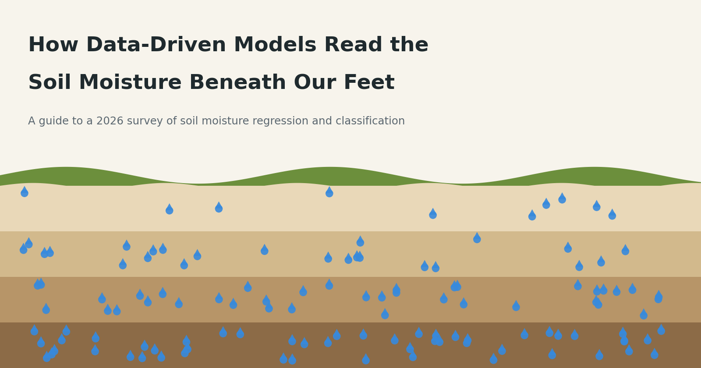
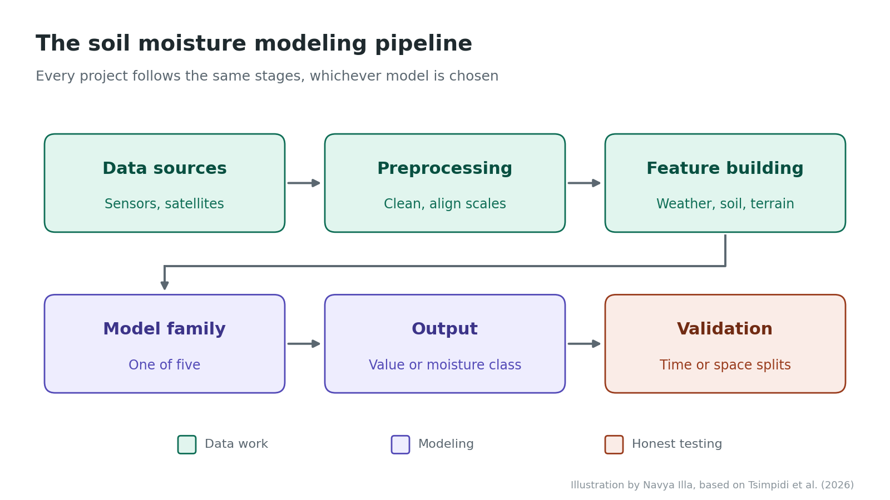
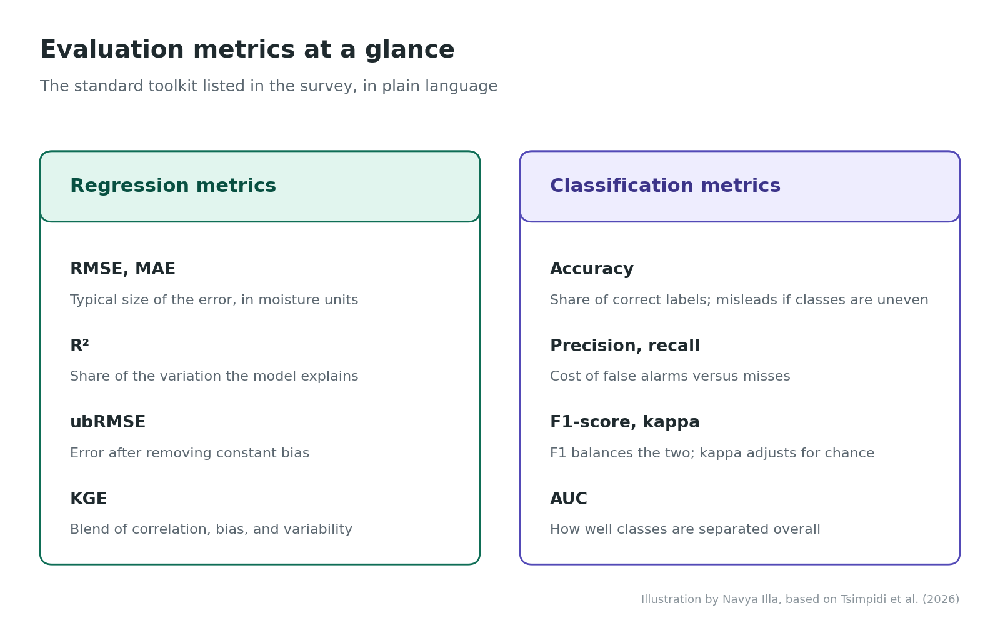
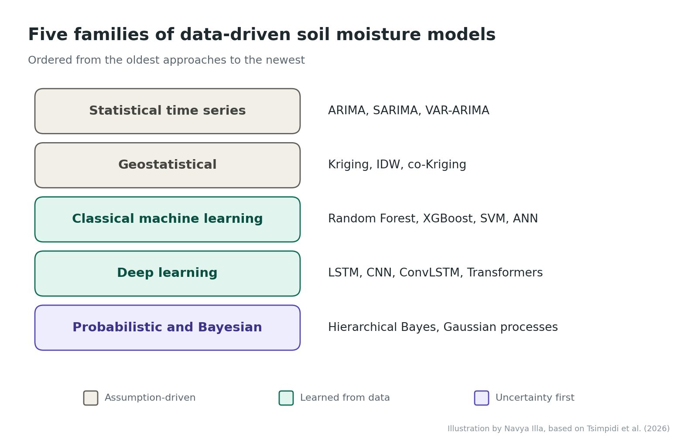
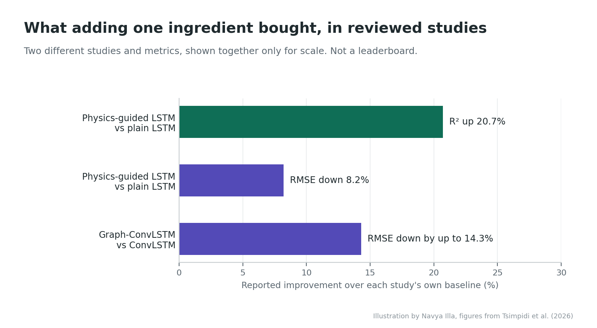
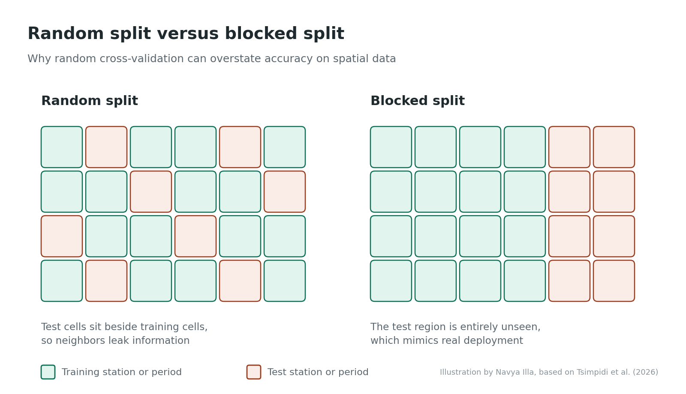

# CMPE 255 Short Story: Soil Moisture and Machine Learning

A paper-review project on the 2026 arXiv survey **[A Survey on Data-Driven Models for Soil Moisture Regression and Classification](https://arxiv.org/pdf/2606.18316)** by Ilektra Tsimpidi, George Georgoulas, Vidya Sumathy, and George Nikolakopoulos. It explains how data-driven models combine ground sensors, satellites, weather, soil, terrain, and history to estimate or classify soil moisture, and why validation design matters as much as the model.

[Read the Medium article](https://medium.com/@9navya9/how-machine-learning-reads-the-moisture-beneath-our-feet-f3fa2096adaf) | [View the slides](https://docs.google.com/presentation/d/17BJrPQ7LwxDE8MK6KnKN7EHg0wbYldsa/edit?usp=sharing)



## Results at a glance

| Model or study | Task | Reported result |
|---|---|---|
| Ordinary Co-Kriging | Precipitation mapping with SMOS soil moisture as a helper variable | R² **0.944 to 0.992** (quarterly) |
| SMRFR (Random Forest) | Five-depth daily soil moisture, 9 km, 2000 to 2023 | Global multilayer product |
| XGBR-GA | High-resolution soil moisture regression | R² **0.891**, RMSE **0.879%** |
| SVM | Drought classification | AUC **0.8166** |
| LSTM | Daily soil moisture forecasting | R² **0.87**, RMSE **0.046** |
| GCCL | 1 to 7 day forecasting on SMAP L4 grids | RMSE **0.018 to 0.038 m³/m³**; up to **14.3%** lower error than ConvLSTM |
| 1D CNN | 6 to 24 inch moisture classes | Accuracy **0.67**, AUC **0.85** |
| PHYs-LSTM | Next-day forecasting with ERA5-Land | R² **+20.7%**, RMSE **-8.2%** versus a conventional LSTM |

These results come from different cited studies and are not a single shared leaderboard. Their inputs, targets, units, regions, depths, horizons, and validation designs must be considered before comparing them.

## Why soil moisture is hard to model

Soil moisture supports drought monitoring, flood forecasting, irrigation, agriculture, and water-resource management. The survey identifies four properties that make it difficult:

- **Spatiotemporal:** location, depth, season, and recent history all matter.
- **Nonlinear:** climate, soil, vegetation, and terrain interact.
- **Multisource:** sensors, satellites, reanalysis, and maps work at different scales.
- **Data-limited:** ground observations are sparse and records are often incomplete.

## Modeling pipeline

The survey describes one shared workflow, whichever model is chosen: data sources, preprocessing, feature construction, model family, outputs, and validation. Typical inputs include precipitation, temperature, solar radiation, vegetation indices, radar backscatter, soil texture, elevation, slope, and antecedent soil moisture.



## Two prediction targets

- **Regression:** continuous soil moisture estimation, temporal forecasting, multi-depth prediction, gap filling, and spatial downscaling.
- **Classification:** moisture states such as dry, moderate, or wet, for drought monitoring and irrigation support.



## Five model families

1. **Statistical time series:** ARIMA, SARIMA, VAR-ARIMA
2. **Geostatistical:** Kriging, IDW, GWR, Co-Kriging
3. **Classical machine learning:** Random Forest, XGBR, ANN, SVM
4. **Deep learning:** LSTM, CNN, GCCL, transformers, physics-guided LSTM
5. **Probabilistic and Bayesian:** Bayesian inverse models, hierarchical Bayesian models, GPR-RU, SGPR



The grid below is my own interpretation of how the families trade off. It is not a result reported in the survey.


## Baseline comparisons

A survey runs no experiments of its own, so it contains no ablation studies. It does report head-to-head comparisons from the reviewed studies:

| Comparison | What was changed | Reported outcome |
|---|---|---|
| PHYs-LSTM vs LSTM | Physical constraints added to training | R² +20.7%; RMSE -8.2% |
| GCCL vs ConvLSTM | Graph component added | RMSE up to 14.3% lower |
| Co-Kriging vs Kriging and IDW | SMOS soil moisture added as an auxiliary variable | Best of the three for precipitation maps |
| XGBR-GA vs RF, SVM, CatBoost | Combined with a genetic algorithm | Best of four; R² = 0.891 |
| Hierarchical vs regular Bayesian | Hierarchical structure across regions | More accurate and precise; fewer false alarms |
| GPR-RU vs generic GPR | Radially Uniform sample design | Lower errors and shorter training time |



The setups differ across studies, so each row should be read on its own.

## Validation must match deployment

Soil moisture is correlated in space and time, so random cross-validation can place near-identical neighbors on both sides of a split and overstate accuracy. The survey recommends designing the split around the deployment question:

- **Forecast a future period:** temporal holdout
- **Map an unseen region:** spatial blocking
- **Generalize to a new station:** leave-one-station-out



## Key takeaways

1. **The target defines the model.** Continuous estimates and moisture classes need different outputs, metrics, and error interpretations.
2. **Validation defines credibility.** Test under the conditions in which the model will be used.
3. **Complexity must earn its place.** Start with a simple baseline such as ARIMA, Kriging, or Random Forest, and add complexity only for a known limitation.

## Critical assessment

The survey offers a clean taxonomy and practical validation advice. Its main limitation is the lack of a common benchmark, so results across studies cannot be ranked directly. Classification receives less attention than regression, and interpretability and uncertainty are named as gaps but only lightly explored. A shared benchmark with fixed spatial and temporal splits would be the most useful next step for the field.

## Repository structure

```text
Assignment-Short-Story-Soil-Moisture-2026/
├── README.md
├── A-Survey-on-Data-Driven-Models-for-Soil-Moisture-Regression-and-Classification.pdf
├── Soil-Moisture-2026 Paper.pptx
└── images/
    ├── 00_cover.png
    ├── 01_pipeline.png
    ├── 02_model_families.png
    ├── 03_tradeoff_grid.png
    ├── 04_validation_split.png
    ├── 05_baseline_comparisons.png
    └── 06_metrics_cheatsheet.png
```
## Medium article

**Medium URL:** [How Data-Driven Models Read the Soil Moisture Beneath Our Feet](https://medium.com/@9navya9/how-machine-learning-reads-the-moisture-beneath-our-feet-f3fa2096adaf)

## Slide deck

A slide deck covering the pipeline, the five model families, the reported results, baseline comparisons, validation, and open research directions.

- [View on Google Slides](https://docs.google.com/presentation/d/17BJrPQ7LwxDE8MK6KnKN7EHg0wbYldsa/edit?usp=sharing)


## Video presentation

_Video link to be added._

## References

1. Tsimpidi, I., Georgoulas, G., Sumathy, V., and Nikolakopoulos, G. (2026). [A Survey on Data-Driven Models for Soil Moisture Regression and Classification](https://arxiv.org/pdf/2606.18316). arXiv:2606.18316.

## Author

Navya Illa  
San José State University
